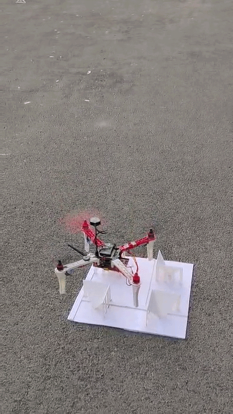
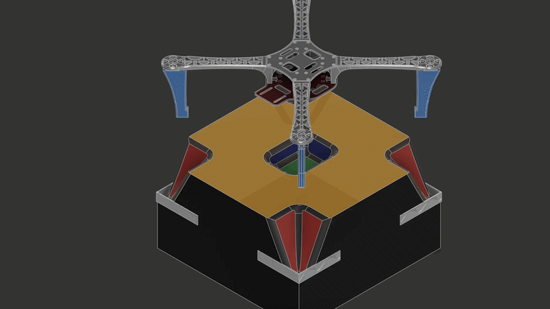

# BASE STATION 
| TEST | DEMO |
| --- | --- |
|  |  |

## The goal it needs to complete 
* Charge the drone.  
* Data transfer. 
* Help drone for navigation.
* Allow drone to make precise landing.
* Use of less electronics for Robustness.
  
## Our reference 
