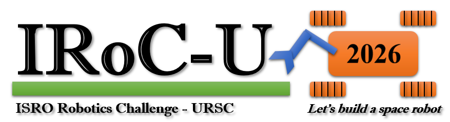
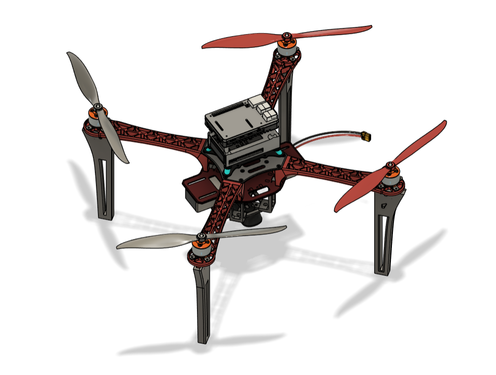
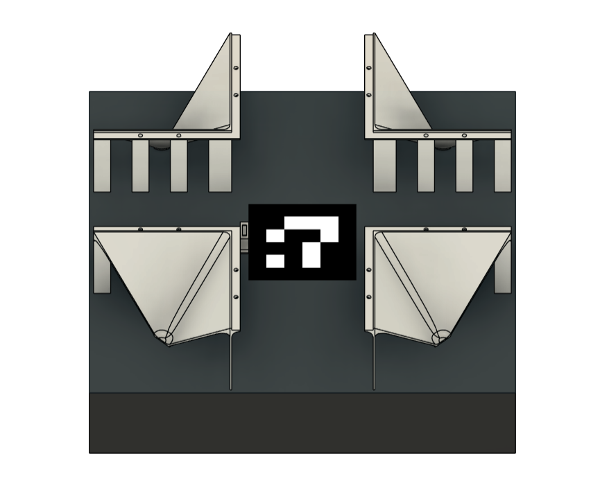
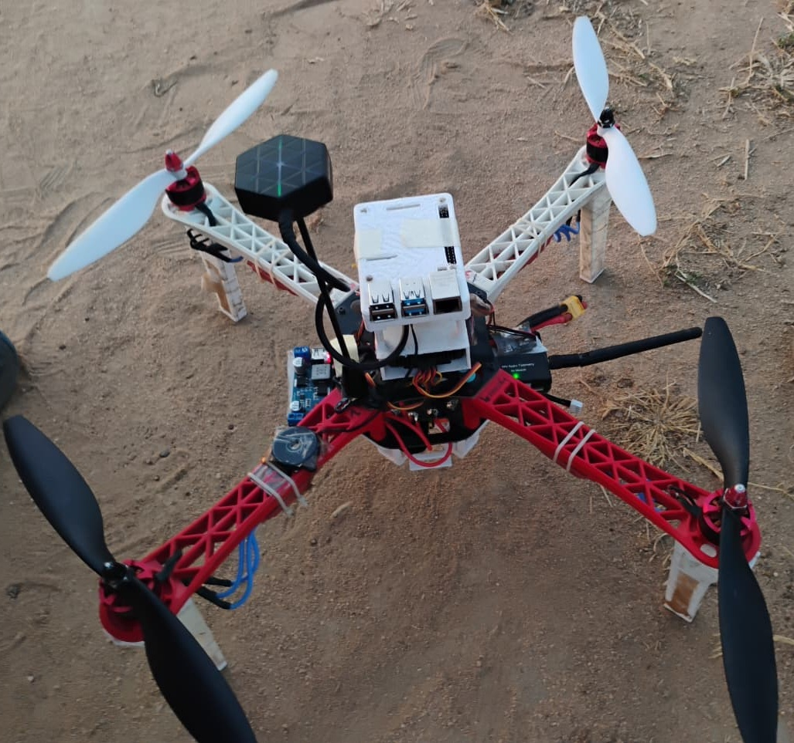
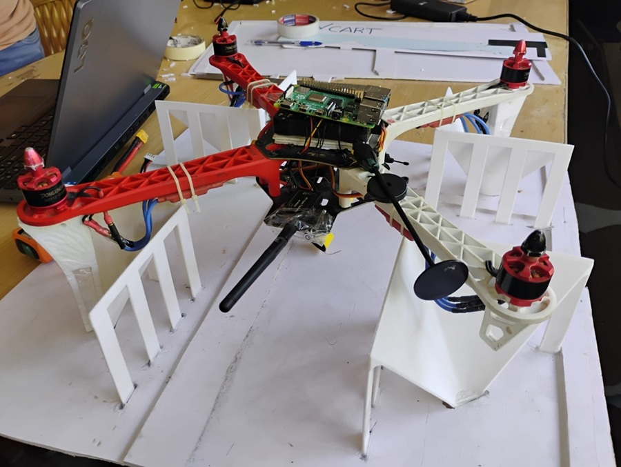

  

# IROC 

**IROC-2026IRoC-U (ISRO Robotics Challenge)** is a national-level student competition organized by the [U R Rao Satellite Centre (URSC)](https://www.ursc.gov.in/) under the Indian Space Research Organisation (ISRO) to engage young engineers in space robotics and planetary exploration.

| YEAR | INTRO | RULE BOOK | Challenge |
| --- | --- | --- | --- |
| [IRoC-U 2024](https://www.ursc.gov.in/IRoC-U2024/index.jsp#main) | Focused on building extra-terrestrial rovers ("Let's build a space robot").| [Click](https://www.ursc.gov.in/IRoC-U2024/challenge.jsp#main) | [Click](https://www.ursc.gov.in/IRoC-U2024/challenge.jsp#main) | 
| [IRoC-U 2025](https://www.ursc.gov.in/IRoC-U2025/index.jsp#main) | Challenged students with autonomous aerial navigation for micro-drones simulating Martian flight without GPS ("Fly me on MARS"). | [Click](https://www.ursc.gov.in/IRoC-U2025/rulebook.jsp#main) | [Click](https://www.ursc.gov.in/IRoC-U2025/challenge.jsp#main) | 
| [IRoC-U 2026](https://www.ursc.gov.in/IRoC-U2026/index.jsp#main) | Centered on “Towards Swarm Expedition: Autonomous Surveyor Challenge for Exploration, Navigation and Dynamics (ASCEND)”, requiring micro-UAV **(Only Single Drone)**, survey, transfer data, and recharge autonomously at base station . | [Click](https://www.ursc.gov.in/IRoC-U2026/rulebook.jsp#main) | [Click](https://www.ursc.gov.in/IRoC-U2026/challenge.jsp#main) | 

### IROC-2025
- [TaemAres_Description] ---> https://drive.google.com/file/d/17FDrEbIm0IxdC7DSrEzdfq-SE-etZ2oC/view?usp=drive_link
- [Video Demonstration]  ---> https://drive.google.com/file/d/1ioCNPwuGKyugktofI9gNkgnuz1UeOkEc/view?usp=drive_link

### IROC-2026
- https://drive.google.com/drive/folders/17m9qbovvHS0LqMVRvw1etUEcNFC9VPUx?usp=drive_link

| Live Stream for 2025 and 2026 | 
| :---: |
| [2025 and 2026](https://www.youtube.com/@urraosatellitecentre/streams) | 

--- 

# IROC-2026 Work_Flow

---

# Design 

| Drone | Base |
| --- | --- |
|  |  |
|  |  |
